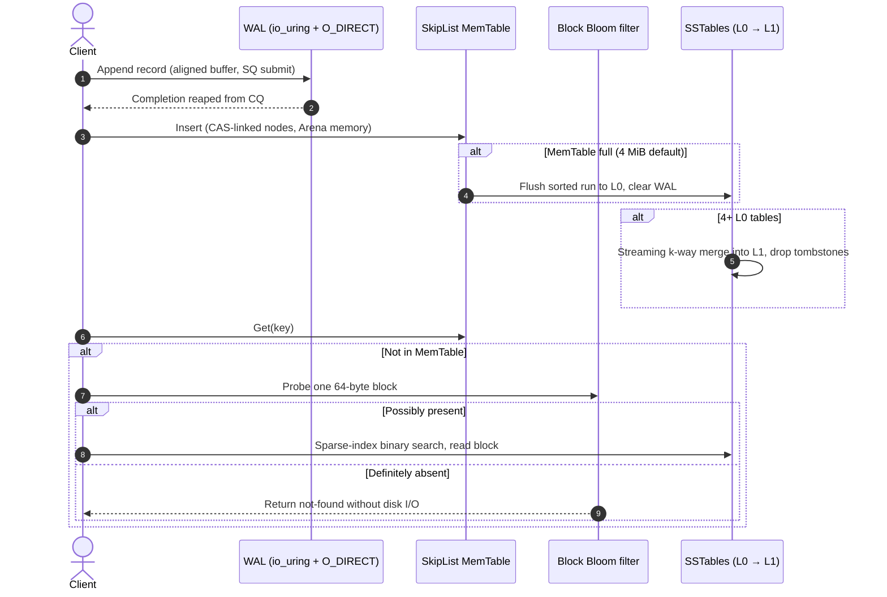

# LSM-Tree Storage Engine

A C++17 log-structured merge-tree key-value engine for Linux: an `io_uring` + `O_DIRECT` write-ahead log, a lock-free SkipList MemTable, cache-line-aligned Block Bloom filters, and leveled compaction.

[](https://en.cppreference.com/w/cpp/17)
[](https://kernel.dk/io_uring.pdf)
[](.github/workflows)
[](LICENSE)

| | |
|---|---|
| **Write path** | `io_uring` + `O_DIRECT` WAL with two acknowledgment modes: `Async` (returns on submission) and `Durable` (returns after `fdatasync`, with group commit). Measured on one VM: ~100k acks/s but ~8k completed-and-synced ops/s in `Async`; 4–6k durable ops/s with 8 writers in `Durable`. See [Benchmarks](#benchmarks) |
| **Correctness** | 15 CTest programs run in CI: randomized put/get/delete and range scans vs a reference map, SIGKILL crash recovery at 20 injected fault points, `-ECANCELED` handling when submitting threads exit, fault injection around WAL writes / flush / compaction, torn and bit-flipped logs, SkipList invariants. A mutation check plants 24 known bugs and requires the suite to catch each (one, a skipped `fdatasync`, is invisible to process-crash tests and is documented as such) |
| **Contract** | [`DURABILITY.md`](DURABILITY.md) states exactly what a returned `put()` guarantees and which failure models are tested |
| **Built by** | Started by [@harsharajkumar-273](https://github.com/harsharajkumar-273); developed with contributors during ELUSOC 2026 (see [Credits](#credits)) |

Benchmark numbers are in [`benchmarks/results.md`](benchmarks/results.md) with hardware, repetitions and raw data, and reproduce with `./build/bench_durability`.

---

## How it works

**Write path.** Every `PUT`/`DELETE` is appended to the WAL, then inserted into the MemTable. What "appended" means when the call returns depends on the durability mode in [`DURABILITY.md`](DURABILITY.md).

- The WAL file is opened with `O_DIRECT`, so writes skip the page cache. Buffers are 512-byte aligned (`posix_memalign`) as `O_DIRECT` requires.
- Appends are submitted through an `io_uring` submission queue and reaped from the completion queue. A mutex serializes submission and assigns each record its file offset, so log order matches write order even though completions arrive out of order.
- `Durable` mode additionally waits for the write to complete and for an `fdatasync`, outside the engine lock so concurrent writers share one `fdatasync` (group commit). `sync()` gives `Async` users an explicit barrier.
- The MemTable is a SkipList with atomic forward pointers. Inserts link nodes with compare-and-swap, so traversals never take a lock. Nodes come from a bump-pointer `Arena` in 1 MB chunks.

**Flush and compaction.** When the MemTable passes its size limit (4 MiB by default) it is flushed to a sorted Level-0 SSTable and the WAL is cleared. Once there are 4 L0 tables, leveled compaction merges them into non-overlapping L1 tables with a streaming k-way merge (bounded memory) and drops tombstones.

**Read path.** Lookups check the MemTable, then L0 tables newest-first, then the one L1 table whose key range matches. Before touching disk, each SSTable's Block Bloom filter is probed. The filter maps every key to a single 64-byte block, so a probe costs at most one cache-line miss and absent keys never reach disk.

**Range scans.** `scan(start, end, limit)` returns live keys in `[start, end)` in order. It opens a cursor on the MemTable and on every SSTable whose key range overlaps the query, positioned with the SkipList search and the sparse index, then merges them with a min-heap ordered by key and source age. The newest version of each key wins, using the same precedence as `get()`, and tombstones hide older values. The engine's shared lock is held for the whole merge, so a scan sees one consistent state.

**Recovery.** On restart the engine replays the WAL, checks each record's CRC32, skips corrupted records, and rebuilds the MemTable.



Deeper design notes: [`ARCHITECTURE.md`](ARCHITECTURE.md).

---

## Benchmarks

Measured on a 4-vCPU Xeon VM, ext4 on a virtual disk, kernel 6.18, 10,000 operations per run, median of 5 runs. Full tables for four record sizes and 1 vs 8 writers, raw data and caveats: [`benchmarks/results.md`](benchmarks/results.md).

Every row below is a **16-byte-value, one-writer** run; the point is how far apart *acknowledged* and *completed-and-durable* are:

| Implementation | `put()` returns when | Ack throughput | Drain to durable | **Durable throughput** |
|---|---|---:|---:|---:|
| `io_uring` + `O_DIRECT` WAL (`Async`) | submitted | 124,854 ops/s | 1,144 ms | **8,226 ops/s** |
| buffered `write()` + one final `fdatasync` | in page cache | 783,207 ops/s | 2 ms | **664,181 ops/s** |
| `io_uring` + `O_DIRECT` WAL (`Durable`) | write done + `fdatasync` | 1,819 ops/s | 0 | **1,819 ops/s** |
| `write()` + `fdatasync` per record | durable | 2,629 ops/s | 0 | **2,628 ops/s** |

With 8 concurrent writers, `Durable` group commit reaches 5.9k ops/s against 3.8k for per-record `fdatasync` (4.2k vs 1.8k at 4 KB values). It is slower than a plain `fdatasync` with a single writer, and the `io_uring` WAL is not faster than buffered I/O at any matched durability level on this hardware. The 254,095 writes/s figure that used to appear here was a submission rate: `bench_write` stopped its clock before the destructor drained the ring, and on this machine that drain is about a second per 10,000 records.

```bash
cmake -B build && cmake --build build -j
./build/bench_durability        # ~15 min; add --quick for a smoke run
ctest --test-dir build          # all correctness tests
python3 tools/mutation_check.py # plants bugs, expects test failures (~30 min)
```

---

## Quick start

```bash
git clone https://github.com/harsharajkumar-273/lsm_tree.git
cd lsm_tree

# Build and run tests + benchmarks in Docker (io_uring needs --privileged)
docker build -t lsm-engine .
docker run --rm --privileged lsm-engine

# Or build natively (Linux 5.1+, liburing)
cmake -B build && cmake --build build -j"$(nproc)"
ctest --test-dir build --output-on-failure
```

An interactive shell is in [`tools/lsm_cli.cpp`](tools/lsm_cli.cpp).

---

## Limitations

- Single-node, single-process engine. No replication or snapshots.
- Two levels (L0 → L1) only.
- In the default `Async` mode a returned `put()` is not durable: it can be lost on a process crash (if still in flight) and on power loss (until `sync()`). Use `WAL::Durability::Durable` for per-write durability. Power-loss behaviour is not tested; see [`DURABILITY.md`](DURABILITY.md#not-covered).
- `O_DIRECT` pads every WAL record to 512 bytes (16x write amplification for small values).
- Benchmarks were recorded on one virtualised machine. Your numbers will differ.

---

## Credits

This engine was built in the open during the ELUSOC 2026 open-source program. [@harsharajkumar-273](https://github.com/harsharajkumar-273) started it and maintains it: architecture, issue triage, design review, and merging. Much of the current WAL, compaction, and test code comes from contributors:

- [@SakethSumanBathini](https://github.com/SakethSumanBathini): WAL write ordering and offsets, fsync and write-failure handling, SkipList invariant tests, bounds and overflow fixes
- [@Myparadox-creator](https://github.com/Myparadox-creator) (Aditya R. Satapathy): streaming k-way compaction with a priority-queue merge ([#100](https://github.com/harsharajkumar-273/lsm_tree/pull/100)), LRU block cache, and their tests
- [@rohitkumarnaidu](https://github.com/rohitkumarnaidu) (Bappadala Rohith Kumar Naidu): features and fixes from the issue tracker

See the [merged pull requests](https://github.com/harsharajkumar-273/lsm_tree/pulls?q=is%3Apr+is%3Amerged) for the full history.

## License

MIT. See [`LICENSE`](LICENSE).
